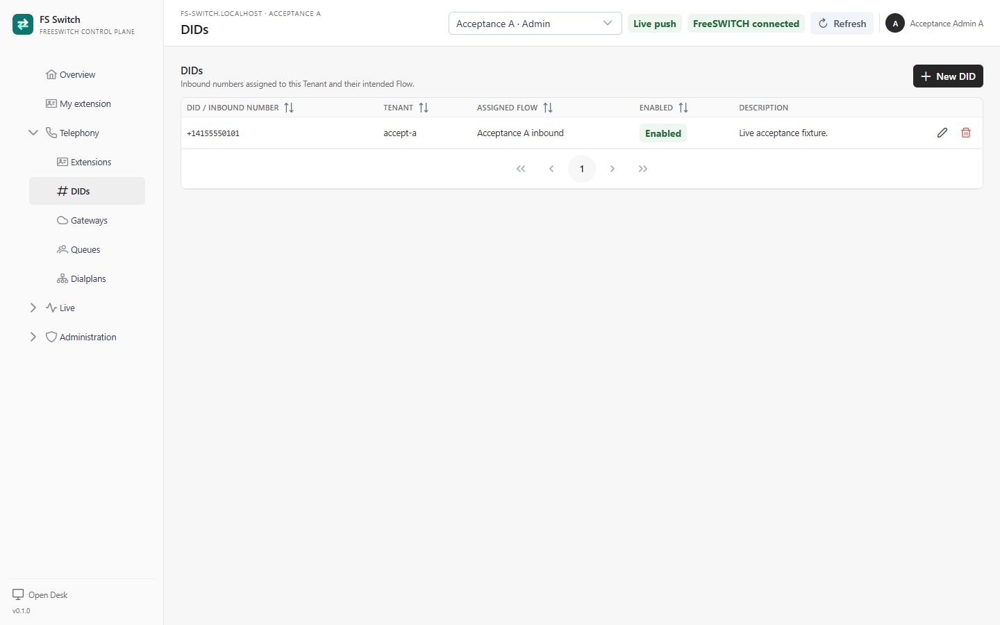
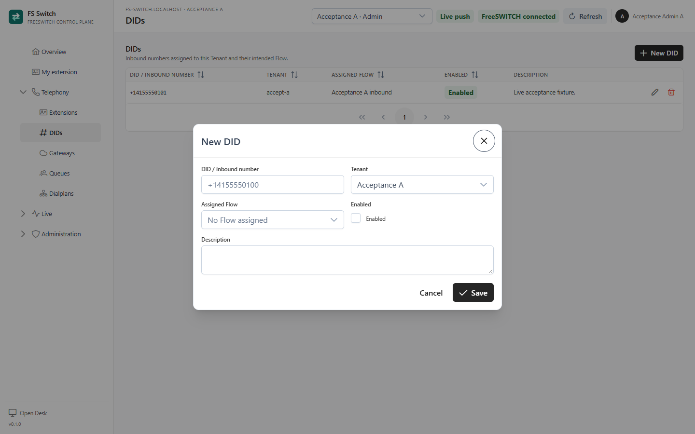

A **DID** (Direct Inward Dialling number) is an inbound phone number assigned to
a Tenant. The **DIDs** page is the Tenant's inbound-number inventory: it records
the number, which Tenant owns it, whether it is enabled, and which Flow is
intended to handle it.

DIDs are not a routing table. A Flow's **Destination** pattern is what FreeSWITCH
matches. The DID record and the Flow pattern must describe the same number.



*The active Tenant's inbound numbers and intended Flows*

## Add an inbound number

1. Select the Tenant in the top bar.
2. Open **Telephony → DIDs**.
3. Click **New DID**.
4. Enter the number in the form the carrier sends it, including `+` when the
   carrier includes it. Spaces, hyphens, parentheses and a `tel:` prefix are
   removed on save.
5. Keep **Enabled** on.
6. Optionally select the **Assigned Flow**. The Flow must belong to the same
   Tenant.
7. Add a description that identifies the carrier, country or purpose.
8. Click **Save**.



*Adding an inbound number*

### Number normalization

FS Switch stores the number with spaces, punctuation and an optional `tel:`
prefix removed, but keeps a leading `+`:

| Entered | Stored |
|---|---|
| `tel:+1 (415) 555-0101` | `+14155550101` |
| `+1 415 555 0101` | `+14155550101` |
| `1-415-555-0101` | `14155550101` |

Uniqueness is checked on the digits only. `+14155550101` and `14155550101`
cannot both exist in the inventory, and a number can belong to only one Tenant.

## Align the Flow destination pattern

The **Destination** field on a Flow is a FreeSWITCH regular expression. It must
match the destination number as FreeSWITCH receives it from the carrier, not
necessarily the way the DID is displayed in the inventory.

Use the narrowest pattern that covers the carrier's format:

| Carrier sends | Flow destination pattern |
|---|---|
| `+14155550101` | `^\+14155550101$` |
| `14155550101` | `^14155550101$` |
| Either form | `^\+?14155550101$` |
| A block of numbers | `^\+?1415555010[0-9]$` |

`+` is a regular-expression operator, so it must be escaped as `\+`. The optional
form `\+?` accepts one or zero plus signs. Do not add a leading or trailing space.
Use the Flow **Simulate** tab with the exact destination the carrier sends and
confirm that the expected branch is reached.

### The Assigned Flow is informational

Selecting a Flow on the DID record documents intent and links the two documents,
but it does not create a FreeSWITCH extension or transfer. The Flow's destination
pattern still does the routing. If the DID says `+14155550101` and the Flow
pattern is `^14155550101$`, the call will not match a carrier that includes the
plus.

## Inbound call path

The current alpha routes inbound calls in this order:

```text
Carrier → gateway → FreeSWITCH context → Flow destination pattern
```

A call entering the gateway's `public` context is forwarded only for the
configured **Main inbound number** in **Settings**, and the transfer target is
the global **Default context**, not a per-Tenant context. Other DIDs need a
public-context route in FreeSWITCH, or the carrier/FreeSWITCH configuration
must send the call into the Tenant's context directly. The DID inventory alone
does not add those routes.

This is an important alpha limitation:

- The DID **Assigned Flow** is not a routing rule.
- The bundled `public` context forwards only `FS Switch Settings → Main inbound
  number` into `FS Switch Settings → Default context`.
- A second Tenant with its own context must be reached by a context-correct
  carrier/FreeSWITCH route; the shared public path does not select that Tenant.
- Multi-DID routing requires FreeSWITCH dialplan or carrier-side context
  configuration beyond the DID record.

For a Tenant with one main number, set **Settings → Main inbound number** to the
number and make the Flow's destination pattern accept the carrier's format. For
multiple numbers, plan the public-context path with the FreeSWITCH
administrator before going live.

## Change the main inbound number

Open **Administration → Settings** as a System Manager. **Main inbound number
(DID)** is the number FreeSWITCH forwards from the `public` context into the
default context.

Keep these values aligned:

1. The carrier's actual number.
2. The main DID in **Settings**.
3. The DID record in the Tenant inventory.
4. The Flow's destination pattern.
5. The main DID allowed by the gateway or carrier.

Changing the DID inventory does not change the main DID. Changing the main DID
does not change any Flow pattern.

## Disable or delete a DID

Disabling or deleting a DID updates the inventory only. It does not remove a
FreeSWITCH dialplan route or stop a carrier from delivering the number. Remove
or change the carrier route separately.

Deleting a DID does not delete its assigned Flow.

## Checklist for a new inbound number

- [ ] The number is in the correct Tenant's DID inventory.
- [ ] The carrier format is known, including the leading `+`.
- [ ] The Flow destination pattern matches that exact format.
- [ ] The Flow is published, not just saved.
- [ ] The Flow context is the Tenant's default context.
- [ ] The main DID or the public-context route is configured in FreeSWITCH.
- [ ] The gateway/carrier is sending calls to the expected context.
- [ ] A test call reaches the expected Flow step.
- [ ] The call appears in **Live → Channels** and, if queued, in the wallboard.

## Troubleshooting

| Symptom | Check |
|---|---|
| `DID ... is already in the inventory` | Numbers are unique across Tenants on digits alone. Remove the duplicate or use a different number. |
| `Flow ... belongs to another Tenant` | The Assigned Flow must belong to the DID's Tenant. |
| Flow simulator matches, but the real call does not | The carrier may add or remove `+`, a country code or a prefix. Compare the actual FreeSWITCH destination with the pattern. |
| The call reaches the wrong Flow | Check Flow priority, the destination pattern, and whether the old Published version is still being served. |
| Another Tenant's DID works but this one does not | Check the public-context route and main DID; DID inventory alone does not route calls. |
| The DID is disabled but calls still arrive | Disabling the inventory row does not change carrier or FreeSWITCH routing. |

## Related pages

- [Tenants and membership](tenants.md)
- [Gateways and carrier trunks](gateways.md)
- [Flows](flows.md)
- [Settings](settings.md)
