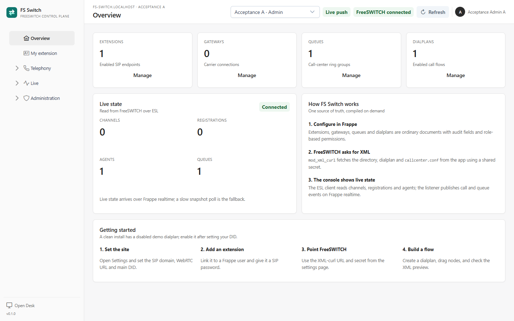
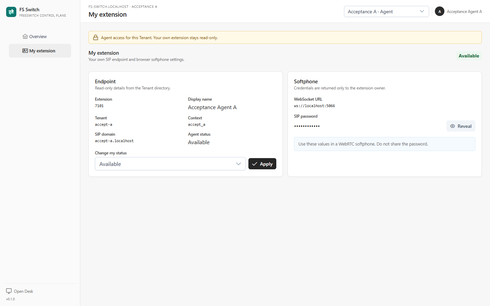
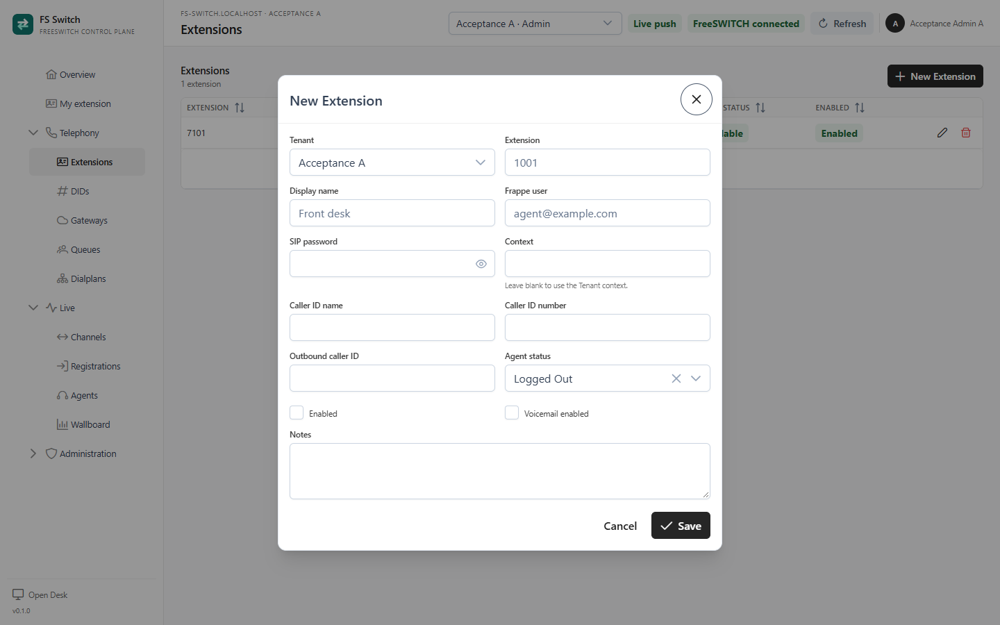
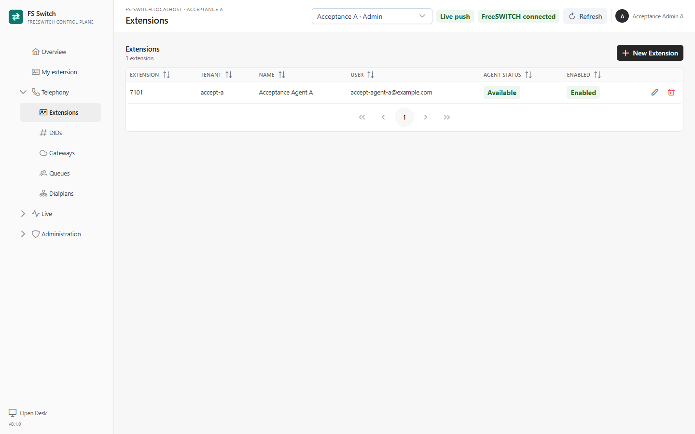
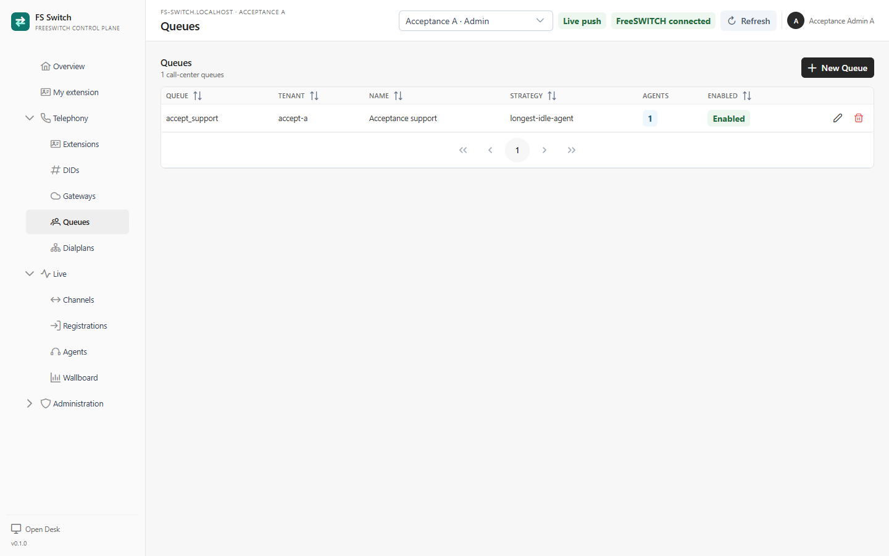
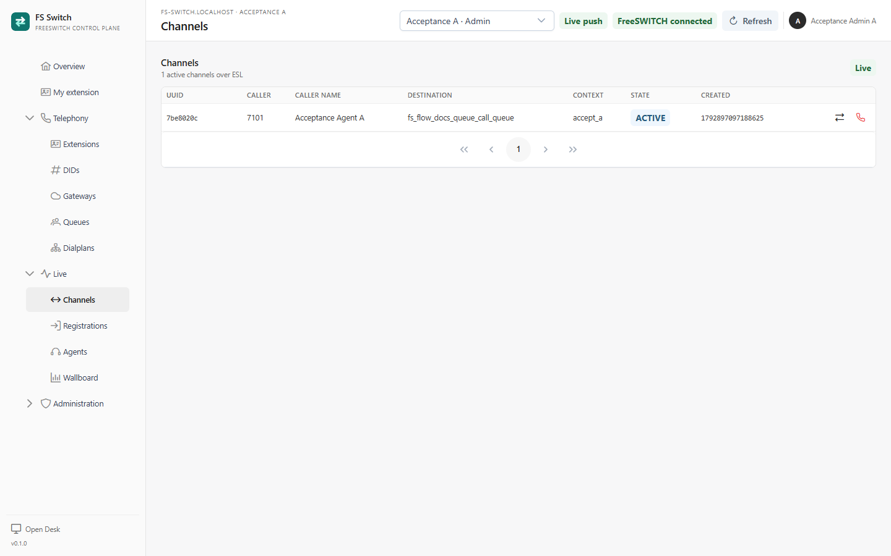
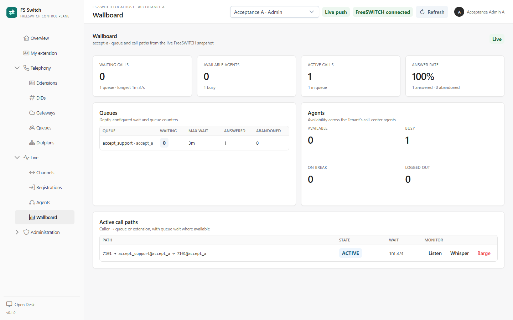
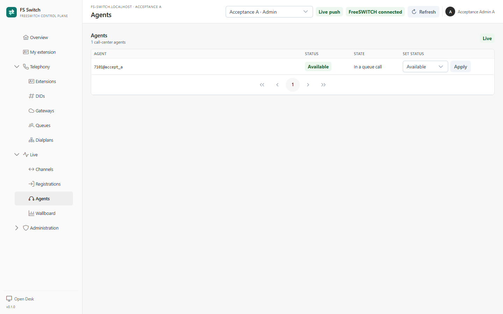

Welcome to FS Switch. This guide takes you from a running console to a published
inbound Flow and a live test call. Allow about 15–30 minutes, plus the time it
takes to register a SIP or WebRTC softphone.

The screenshots use the sample Tenant **Acceptance A** and the queue
`accept_support`. Use your own Tenant, extension and destination names; the
buttons and workflow are the same.

## Finding your way around

The console is served at `/fs-switch`. After login, it opens on **Overview**:



*Overview for a Tenant Admin*

The screen has four parts:

- **Top bar** - the active Tenant, realtime status (**Live push**),
  FreeSWITCH connection status and **Refresh**.
- **Sidebar** - **Overview**, **My extension**, **Telephony**, **Live** and,
  for the appropriate roles, **Administration**.
- **Workspace** - the list, form or Flow you are working on.
- **Getting started** - a short checklist for a new installation. It is a
  reminder, not a wizard; the steps below follow the same order.

The sidebar is role-aware. A Tenant Admin can configure and publish. A
Supervisor can read configuration and run live actions. An Agent sees only
**Overview** and **My extension**.

## 1. Choose the Tenant

Use the selector in the top bar to choose the Tenant you are working in.
Everything you create next - extensions, queues, DIDs and Flows - belongs to
that Tenant.

A Tenant is one customer organisation. It owns its SIP domain, default context,
inbound numbers, extensions and Flows. A user can be a member of more than one
Tenant; switching the selector changes the data and the realtime scope.

The Tenant field on a document is fixed after creation. Check the selector
before you click **New**.

## 2. Check your own extension

Open **My extension**:



*An Agent's own endpoint and softphone settings*

If your account has an extension, the page shows:

- **Extension**, display name, Tenant, context and SIP domain.
- **WebSocket URL** for a WebRTC softphone, commonly
  `ws://localhost:5066` in a local lab.
- **SIP password**, hidden until you click **Reveal**.
- **Agent status** with **Available**, **On Break** and **Logged Out**.

An Agent can change their own status but cannot edit the endpoint. A Tenant
Admin or System Manager creates and edits extensions in **Telephony →
Extensions**.

FS Switch does not ship an embedded softphone in this alpha. Use a SIP or WebRTC
softphone and enter the extension, SIP password and WebSocket URL from this
page. For a local lab, use `ws://`; `wss://` requires a trusted certificate.

## 3. Create the building blocks

### Extensions

Go to **Telephony → Extensions** and click **New Extension**.



*Creating an extension*

Fill in:

| Field | What it does |
|---|---|
| Tenant | Defaults to the active Tenant; fixed after save. |
| Extension | The SIP user, for example `1001`. |
| Display name | The name shown to other users and in live views. |
| Frappe user | Links the endpoint to the user who can see **My extension**. |
| SIP password | Required. Use a strong password and store it safely. |
| Context | Leave blank to use the Tenant's context. |
| Agent status | **Logged Out**, **Available** or **On Break**. Queue calls only reach available agents. |
| Enabled | Whether FreeSWITCH should load the endpoint. |

Save the extension, then open **My extension** as that user and reveal the SIP
password for your softphone. The extension appears in the Extensions list:



*The Tenant's extensions*

### Queues

A queue is a call-center ring group. Go to **Telephony → Queues → New Queue**
and set the queue name, strategy, maximum wait, music on hold and backup queue.
Add the agent extensions on the **Agents** tab. Every agent and backup queue
must belong to the same Tenant.



*The Tenant's queues*

Keep the extension's agent status **Available** when you want queue calls to
reach it.

## 4. Build your first Flow

Go to **Telephony → Dialplans** and click **New semantic flow**.


*Flows and their published versions*

A Flow is the graph of steps an inbound call follows. The canvas, the Table
view and the XML preview are projections of the same graph. The XML is compiler
output and is read-only.

### Add steps

The semantic palette on the left contains intent-level steps such as **Answer**,
**Play prompt**, **IVR menu**, **Ring group**, **Call-center queue**,
**Voicemail**, **Set variable** and **Hang up**. Drag a step onto the canvas or
click it to add it.


*A semantic Flow with an IVR menu and two branches*

A typical first Flow is:

```text
Answer → IVR menu ─ digit 1 → Ring group → Hang up
                  ├ digit 2 → Call-center queue → Hang up
                  └ timeout → Voicemail
```

### Connect the ports

Each step exposes named output **Ports** for its outcomes. Connect the output to
the next step's input:

- **Answer** and **Play prompt** expose `Next`.
- **IVR menu** exposes one port per configured digit plus `Timeout`.
- **Time condition** exposes `Match` and `No-match`.
- **Hang up**, **Voicemail**, **Transfer**, **Conference** and **Park** are
  terminal steps with no output.
- **Ring group** and **Call-center queue** expose `Next`.

Click a step to open its property drawer and configure the details. The entry
step is marked on the canvas; set it in **Settings** if the first step should be
different.

Validation runs while you edit. A non-terminal output must be connected before
the Flow can be saved. The green banner at the top tells you whether the graph
is valid.

### Prompts and media

The **IVR menu** and **Play prompt** nodes take a FreeSWITCH playback path, for
example `ivr/ivr-welcome_to_freeswitch.wav`. The file must exist in the
FreeSWITCH sounds directory or be a valid stream URI. This alpha does not have a
media-library UI; use an existing prompt or a stream such as
`silence_stream://1000` for a smoke test.

### Save, simulate, publish

Click **Save** to store the Draft. A saved Draft is not served to FreeSWITCH.

Open **Simulate** to walk the Draft graph with a destination, time and optional
digits:


*Simulating destination `18005550100` with digit `2`*

The result lists each step, the output port it took and a detail line. Simulated
steps are highlighted on the canvas. The simulator walks the graph, never the
compiled XML.

When the Flow is valid and the simulation looks right, click **Publish**. The
toolbar shows the Published version. XML-curl serves only the Published version;
saving another Draft later does not change live routing until you publish again.

Use **Draft vs Published** before publishing to review the graph and XML
difference. To return to an earlier version, open **Published versions** in the
Dialplans list and roll back. Rollback preserves the Draft.

## 5. Test a call

1. Register a SIP or WebRTC softphone with the extension and password from
   **My extension**.
2. Set the extension's agent status to **Available** if the Flow ends in a
   queue.
3. Call the destination number that matches the Flow's **Destination** pattern.
   The documentation example uses `18005550100`; use the number you configured.
4. Watch **Live → Channels**:



*An active queue call in Live → Channels*

The Channels grid shows the active call legs, caller, context, state and the
actions available to a Supervisor. If the call does not appear, check that the
Flow is Published and that the destination matches the Flow pattern.

A call that arrives from a carrier still needs an **FS Gateway** and an inbound
number assigned to the Tenant. For a local test, use a softphone or a test route
that reaches FreeSWITCH directly.

## 6. Supervise the queue

Open **Live → Wallboard**:



*Queue depth, agent availability and an active call path*

The wallboard shows:

- **Waiting calls** and the longest current wait.
- **Available agents** and busy, on-break or logged-out agents.
- **Active calls** and the answer rate from the queue counters.
- Per-queue depth, configured maximum wait and answered/abandoned counts.
- **Active call paths** from caller to queue to agent.

The wallboard refreshes every 10 seconds while it is open and also applies live
Socket.IO events. A Supervisor can use **Listen**, **Whisper** or **Barge** on a
call path. The action rings the supervisor's own extension and starts a
FreeSWITCH `eavesdrop` leg:

- **Listen** - hear the call without being heard.
- **Whisper** - speak to the agent only.
- **Barge** - join the conversation.

You need an extension and a registered softphone for monitoring. The console
does not play monitor audio in the browser yet.

**Live → Agents** shows the call-center status and the **In a queue call** state
for each agent:



*Agent availability and current state*

## 7. Prepare for inbound carrier traffic

The first Flow is enough to test a softphone. Before a carrier goes live, add
the Tenant's inbound numbers and connect a gateway.

### Add inbound numbers

1. Open **Telephony → DIDs → New DID**.
2. Add the number in the form the carrier sends it, including `+` if present.
3. Enable the DID and optionally select the Flow that should handle it.
4. Make the Flow's **Destination** regex match the carrier's exact format.

For example, a carrier sending `+14155550101` needs a Flow pattern such as
`^\+14155550101$`; a carrier sending `14155550101` needs
`^14155550101$`. Use `^\+?14155550101$` when both forms are possible. The public DID map transfers
the call into the Tenant context; the Flow pattern still has to match the
carrier's number. See [DIDs and inbound numbers](dids.md).

### Add a second Tenant

1. Open **Administration → Tenants → New Tenant** as a System Manager.
2. Give the Tenant a unique SIP domain and default context.
3. Add members by their existing Frappe user email and choose Admin,
   Supervisor or Agent.
4. Save, then switch to the Tenant in the top bar.

The console does not create or invite the Frappe user. Create or invite the user
in **Open Desk → User** first, then add the membership. See
[Tenants and membership](tenants.md).

### Add a gateway before the carrier trunk

1. Open **Telephony → Gateways → New Gateway**.
2. Record the carrier proxy, registration credentials, caller ID and context.
3. Create the matching SIP gateway in FreeSWITCH and load it.
4. Add the inbound numbers and align the Flow patterns.
5. Test both directions.

In this alpha the **FS Gateway** record is inventory only; it does not generate
the FreeSWITCH gateway or register to the carrier. The shared `public` context
uses the DID map to reach the correct Tenant; a DID without a Flow can use the
Tenant main inbound number. See [Gateways and carrier trunks](gateways.md).

## 8. What next

- Review [`DIDs and inbound numbers`](dids.md), [`Gateways and carrier trunks`](gateways.md),
  [`Queues and agents`](queues.md) and [`Flows`](flows.md) for the detailed
  operational rules.
- Review [`operations.md`](operations.md) for publish, rollback, cache, ESL and
  troubleshooting.
- Read [`flow-model.md`](flow-model.md) for the Flow schema, compiler,
  simulator and publish lifecycle.
- Read [`ui.md`](ui.md) for the console layout and role model.
- Use [`troubleshooting.md`](troubleshooting.md) before changing several layers
  at once.

The current alpha still has limitations: no embedded softphone, no in-console
monitor audio, no media library, no automatic gateway generation and no full
CDR/recording history. Check [`DEFERRED.md`](DEFERRED.md) before planning a
production rollout.
