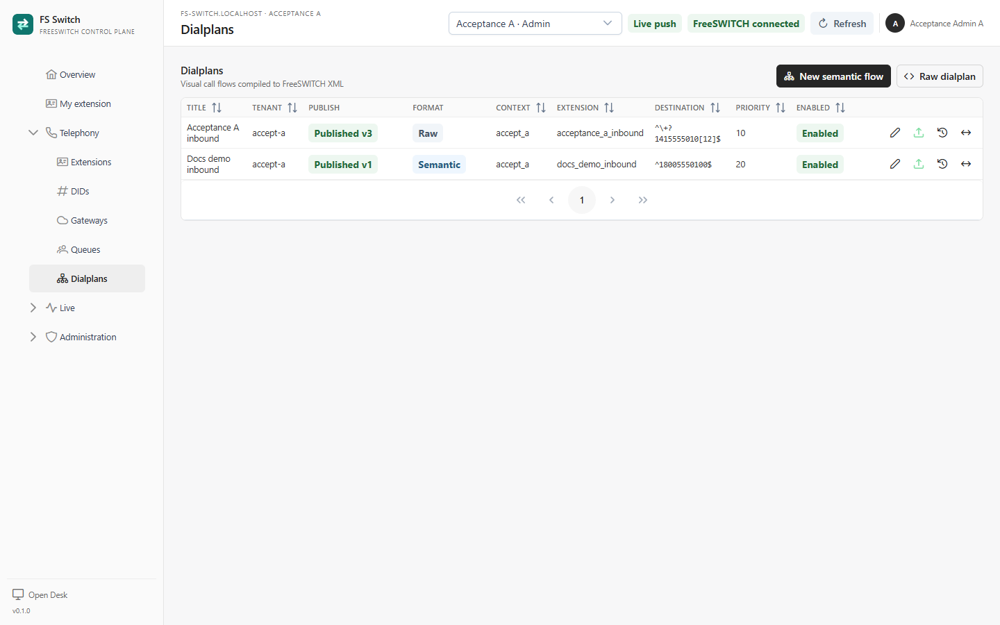
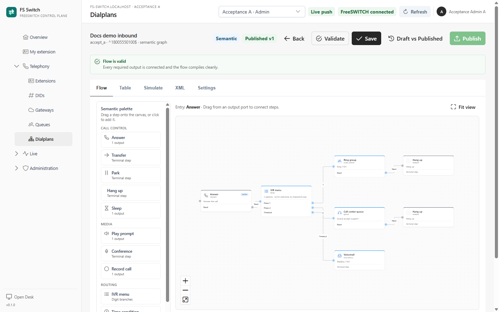
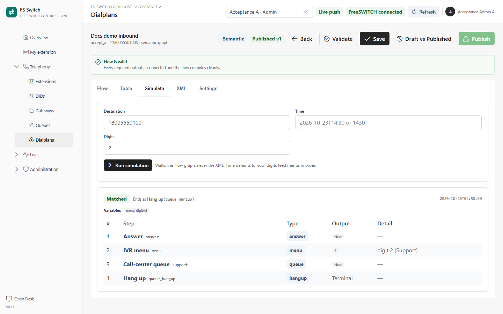

A **Flow** is the graph of call-handling steps for one inbound destination. It
is the single source of truth. The canvas, the Table view and the XML preview
are projections of the same graph. The XML is compiler output and is read only.

A Flow has a **Draft** and one or more **Published** versions. Saving changes the
Draft. Publishing compiles the Draft and makes it the version XML-curl serves to
FreeSWITCH.

*Flows, formats and published versions*

## Create a Flow

1. Select the Tenant in the top bar.
2. Open **Telephony → Dialplans**.
3. Click **New semantic flow**.
4. Set the title, extension name, destination pattern, priority and entry step
   in **Settings**.
5. Add steps from the palette.
6. Connect every non-terminal output.
7. Validate and save the Draft.
8. Simulate the relevant destinations and digits.
9. Review **Draft vs Published** and publish.

The **Raw dialplan** option is an advanced escape hatch for a linear FreeSWITCH
application chain. Semantic Flows are the default product model.

## Settings

| Field | Purpose |
|---|---|
| **Title** | Operator-facing Flow name. |
| **Tenant** | Owner Tenant; fixed after creation. |
| **Context** | Must be the Tenant's default context. |
| **Extension name** | Name of the compiled entry extension. |
| **Destination** | FreeSWITCH regular expression for the inbound number. |
| **Priority** | Order when multiple Published Flows could match. Lower numbers run first. |
| **Enabled** | Whether the Published Flow is served. |
| **Entry step** | The first semantic step followed by the compiler. |

The destination pattern must match the number as FreeSWITCH receives it. See
[DIDs and inbound numbers](dids.md) for examples and the current public-context
limitation.

## Canvas, ports and validation

*A valid semantic Flow with an IVR menu, queue, ring group and voicemail*

Each node exposes named output **Ports** for its outcomes. Drag from a port to
the next node's input:

- **Answer**, **Play prompt**, **Ring group**, **Queue**, **Set variable**,
  **Sleep** and **Record call** expose `Next`.
- **IVR menu** exposes one port per configured digit plus `Timeout`.
- **Time condition** exposes `Match` and `No-match`.
- **Voicemail**, **Transfer**, **Conference**, **Park** and **Hang up** are
  terminal and expose no output.

Validation runs as you edit and again before save. It rejects:

- unknown node types;
- missing required fields;
- missing edges from non-terminal ports;
- edges from terminal nodes;
- duplicate or malformed IDs;
- unreachable nodes;
- invalid menu options or duplicate digits;
- a Flow with no entry step.

The **Flow is valid** banner means Save is allowed. A Draft is not served to
FreeSWITCH until it is published.

A loop is allowed in the graph, but it has no automatic exit. Use a loop only
with a timeout, a menu, a variable condition reached through a later step, or a
deliberate terminal path. Test it in a lab and keep an operator hangup path.

## Node reference

| Node | Required settings | Output | What it compiles to |
|---|---|---|---|
| **Answer** | none | Next | `answer` |
| **Play prompt** | prompt | Next | `playback` |
| **IVR menu** | prompt, options | digit ports + timeout | `play_and_get_digits` and branch selectors |
| **Time condition** | expression, optional field | match, no-match | variable condition branches |
| **Ring group** | endpoints, timeout | Next | `bridge` to one or more endpoints |
| **Call-center queue** | queue | Next | `callcenter` |
| **Voicemail** | mailbox, optional profile/domain | terminal | `voicemail` |
| **Transfer** | destination, optional dialplan/context | terminal | `transfer` |
| **Conference** | room, optional profile | terminal | `conference` |
| **Park** | none | terminal | `park` |
| **Set variable** | variable, value | Next | `set` |
| **Sleep** | milliseconds | Next | `sleep` |
| **Record call** | path | Next | `record_session` |
| **Hang up** | optional cause | terminal | `hangup` |

### IVR menu details

- The prompt must exist in FreeSWITCH or be a valid stream URI.
- `min_digits` and `max_digits` must be 1 for digit branches.
- Each digit is a single `0`–`9` value and cannot repeat.
- `tries` and `timeout_ms` control retries and the wait for a digit.
- `invalid_prompt` is the playback for an invalid entry.
- The timeout branch runs when no digit is collected.

### Time condition details

The condition compares a field, by default `${strftime(%H%M)}`, against an
expression. Use the **Route simulator** with a representative time. The
simulator does not evaluate FreeSWITCH's native `wday`, `hour` or
`minute-of-day` fields; use `${strftime(...)}` or a set variable for conditions
that must simulate accurately.

### Ring group and queue details

- Ring group endpoints can be extension numbers (converted to
  `user/<extension>@${domain_name}`) or explicit dial strings.
- The ring-group timeout is passed as `leg_timeout`.
- A queue resolves to `<queue>@<context>`; the context comes from the Flow unless
  the queue node supplies one.
- The queue and its agents must exist and be loaded in FreeSWITCH.

### Prompts and media

The **Play prompt** and **IVR menu** nodes take a FreeSWITCH playback path, not
an uploaded file. Use a path present in the FreeSWITCH sounds directory or a
valid stream such as `silence_stream://1000` for a smoke test. This alpha does
not include a media-library UI.

## Table view

The **Table** tab edits the same steps and connections as a grid. It includes the
entry step and delete controls. It is useful for reviewing a large graph and for
copying exact node properties. Changes made in the table are the same Draft
changes made on the canvas.

## Simulate

*Simulating a destination, time and menu digit*

The **Simulate** tab walks the Draft graph, never the compiled XML, with:

- **Destination** - the number the Flow should match;
- **Time** - the time used by time conditions;
- **Digits** - menu inputs in order.

The result shows the matched/not-matched status, the variables collected, every
step in the path, the output port taken and a detail line. Simulated nodes are
highlighted on the canvas. An invalid Flow returns the validation errors instead
of pretending to route.

The simulator is a graph check, not a media or carrier test. It does not play
prompts, register a phone or contact a carrier.

## XML preview

The **XML** tab shows the Draft compiled by the same compiler FreeSWITCH uses.
It is a preview and is read only. The Published XML is kept separately and is
what XML-curl serves.

The XML preview is useful for checking extension names, branch conditions,
transfers and queue names before publish. Do not edit it; edit the Flow.

## Save, publish, diff and rollback

1. **Save** persists the Draft.
2. **Draft vs Published** compares the saved Draft with the Published version:
   settings, entry step, step and connection changes, and a unified XML diff.
3. **Publish** compiles the saved Draft and makes it the served version. The
   response includes the version and the `reloadxml` result.
4. **Published versions** opens the immutable history. **Rollback** repoints the
   Published version to an earlier one; the Draft is preserved.
5. If the Draft differs again after rollback, the publish status returns to
   `Draft` until published.

A failed `reloadxml` does not undo a successful publish. Run `reloadxml` from
`fs_cli` and verify the call path. Saving a Draft never changes live routing.

## Raw dialplans

The raw editor stores a linear list of FreeSWITCH application nodes. It is
retained for engineers who need an application that has no semantic node. The
raw graph is compiled in topological order and rejects cycles. Use the semantic
editor unless you specifically need raw application control.

## Routing and the call path

The compiled Flow is served only when:

- the Flow is **Published** and **Enabled**;
- the Tenant context matches the request;
- the destination pattern matches;
- no earlier Flow with the same match takes priority.

XML-curl serves the Published XML. Drafts, simulator results and the XML preview
are never used on the call-setup path.

## Common problems

| Symptom | Check |
|---|---|
| Save is blocked | Every non-terminal output connected, required fields set, no unreachable node. |
| Simulator matches but a real call does not | Carrier format, context, priority and Published version. |
| `Flow is valid` but calls use old routing | Publish; XML-curl serves only Published XML. |
| Prompt does not play | The path exists in FreeSWITCH or use a stream URI. |
| Queue node fails | Queue exists, same Tenant, agents available and loaded. |
| Publish reports `reloadxml` failure | Run `reloadxml` from `fs_cli`; check FreeSWITCH logs. |
| A second Tenant's Flow is never reached | The public context forwards only the global main DID into the global default context; configure a context-correct inbound route. |

## Related pages

- [DIDs and inbound numbers](dids.md)
- [Queues and agents](queues.md)
- [Tenants and membership](tenants.md)
- [Live operations](live-operations.md)
- [`flow-model.md`](flow-model.md) - implementation details for the compiler and graph
- [`operations.md`](operations.md) - publish, cache and rollback operations
