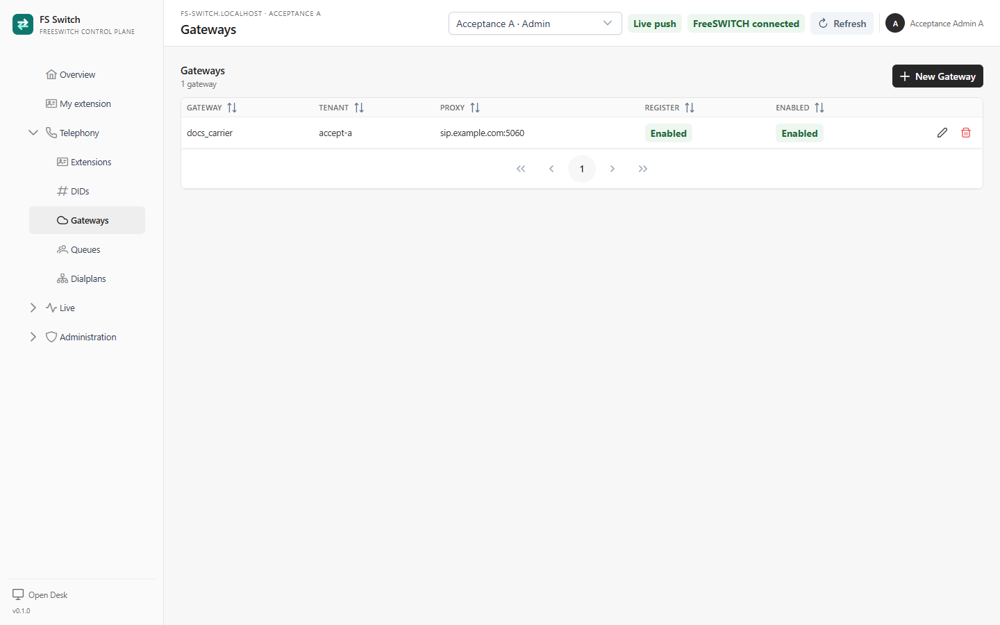
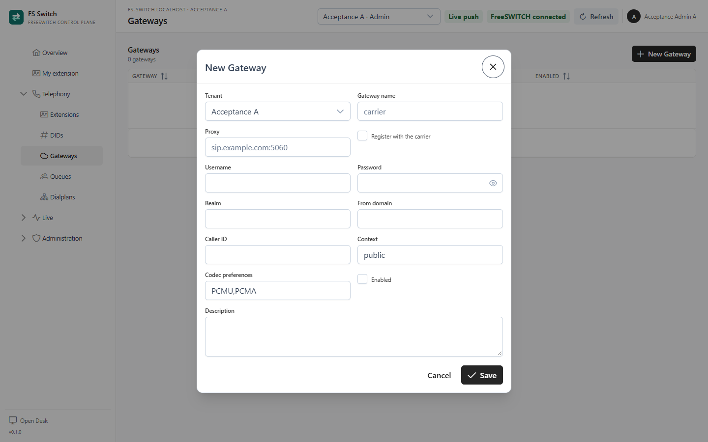

An **FS Gateway** is the Tenant's record of a carrier or SIP trunk. It keeps the
carrier name, proxy, registration credentials, caller ID, codec preferences and
inbound context together so the console and the FreeSWITCH configuration can be
kept in sync.

> **Alpha limitation:** FS Switch currently stores gateway records but does not
> generate a FreeSWITCH SIP gateway or register to the carrier. The actual
> gateway must still be configured in FreeSWITCH. Use the FS Gateway record as
> the inventory and hand-off for that configuration; do not assume that saving
> the record creates a trunk.



*A Tenant's gateway record*

## Add a gateway

1. Select the Tenant in the top bar.
2. Open **Telephony → Gateways**.
3. Click **New Gateway**.
4. Enter a **Gateway name** that matches the name you will use in FreeSWITCH.
5. Enter the carrier **Proxy**, usually `host:port`.
6. Turn on **Register with the carrier** when the carrier requires registration.
7. Fill in **Username**, **Password**, **Realm** and **From domain** when the
   carrier provides them.
8. Set **Caller ID** for outbound calls when the carrier requires one.
9. Keep **Context** as `public` unless the carrier or FreeSWITCH administrator
   specifies another inbound context.
10. Set **Codec preferences**, for example `PCMU,PCMA`.
11. Keep **Enabled** on when the trunk is ready.
12. Save.



*Gateway fields used to prepare a carrier trunk*

Passwords are stored in the DocType and should be treated as carrier
credentials. Do not put them in a ticket, screenshot or repository.

## Connect the carrier trunk

The console record is only one side of the connection. Complete these steps
before sending production calls:

1. **Create the FS Gateway record** in FS Switch.
2. **Create the matching gateway in FreeSWITCH.** Use the same gateway name,
   proxy, registration credentials, realm, from-domain, caller ID and codec
   preferences. Follow the carrier's FreeSWITCH/SIP instructions; this alpha
   does not generate the SIP profile or gateway XML.
3. **Set the inbound context.** Carrier calls typically arrive in `public`.
   The public dialplan uses the enabled DID map: an assigned Published Flow
   routes into that Tenant's context; a DID with no Flow falls back to the
   Tenant **Main inbound number**; the global **Settings → Main inbound number**
   remains the final legacy fallback. Make the gateway's **Context** field and
   the real FreeSWITCH context agree; the record itself is still inventory, not
   a routing rule.
4. **Set the default gateway reference.** In **Settings → Default gateway**,
   select the record if you want the console and future outbound features to
   have a default. The field is metadata in this alpha; it does not currently
   choose a gateway for a Flow automatically.
5. **Add the DIDs** in **Telephony → DIDs** and align each Flow's destination
   pattern with the carrier's number format.
6. **Publish the Flow.** XML-curl serves only the Published version.
7. **Verify registration and media** before routing a real number. Place a test
   call in both directions.

For an outbound route, the Flow must use a FreeSWITCH action that actually
bridges through the gateway. A Gateway record or a **Default gateway** setting
does not create an outbound route by itself.

## Gateway fields

| Field | Purpose |
|---|---|
| **Gateway name** | Natural name, unique within the Tenant, for example `carrier-us`. |
| **Proxy** | Carrier SIP host and port, for example `sip.example.com:5060`. |
| **Register with the carrier** | Whether FreeSWITCH should register to the carrier. |
| **Username / Password** | SIP registration credentials. |
| **Realm** | SIP realm when the carrier requires it. |
| **From domain** | Domain used in the From header. |
| **Caller ID** | Default outbound caller ID for this gateway. |
| **Context** | Inbound context for calls from the trunk; normally `public`. |
| **Codec preferences** | Codec order, for example `PCMU,PCMA`. |
| **Enabled** | Whether the record is active in the inventory. |
| **Description** | Carrier, circuit, region or support notes. |

The natural gateway name is unique inside one Tenant. The document itself uses a
Tenant-qualified name, such as `accept-a::docs_carrier`.

## Verify a trunk

Use FreeSWITCH itself for the connection checks:

```bash
fs_cli -x "sofia status"
fs_cli -x "sofia status gateway <gateway-name>"
fs_cli -x "sofia profile <profile> rescan"
```

The exact profile and gateway name depend on your FreeSWITCH configuration. A
successful registration should show `REGED`; an unreachable carrier or wrong
credentials should show a registration error.

Then test:

1. An inbound call from the carrier reaches the expected DID/Flow.
2. The call appears in **Live → Channels** with the expected caller.
3. Audio works in both directions.
4. An outbound call uses the intended gateway and caller ID.
5. Codec negotiation matches the carrier.

## Common problems

| Symptom | Check |
|---|---|
| Gateway missing after save | The record belongs to the active Tenant. Switch Tenant and check again. |
| FreeSWITCH has no gateway | The record is inventory only. Create the gateway in the FreeSWITCH SIP profile and reload it. |
| Registration fails | Proxy, username, password, realm, from-domain and carrier IP allowlist. |
| One-way audio | RTP range, NAT/public media IP, firewall and codec. |
| Carrier delivers calls but the Flow does not run | The call is in a different context, the Flow is not Published, or the destination pattern does not match the delivered number. |
| A DID does not route | Is the DID enabled, is its Flow Published and in the same Tenant, or does the Tenant have a Main inbound number? Check the public dialplan cache. |
| Outbound calls ignore the gateway | A Gateway record does not create an outbound route. Bridge through the configured FreeSWITCH gateway in the Flow or dialplan. |
| Wrong caller ID | Check the gateway, Tenant and extension caller-ID values; the extension value takes precedence for that endpoint. |

## Security and operations

- Restrict who can read carrier credentials. The console's Tenant Admin role can
  manage gateways; Agents cannot.
- Rotate a carrier password in both FreeSWITCH and FS Switch. The two systems do
  not share a credential store.
- Back up the FreeSWITCH SIP profile and gateway configuration separately; the
  FS Gateway record is not a backup of the live trunk.
- This alpha has no carrier templates, gateway failover, least-cost routing or
  rate decks. Treat those as separate production projects.

## Related pages

- [DIDs and inbound numbers](dids.md)
- [Tenants and membership](tenants.md)
- [Flows](flows.md)
- [Settings](settings.md)
- [Live operations](live-operations.md)
- [`operations.md`](operations.md) - XML-curl, ESL, cache and runtime checks
