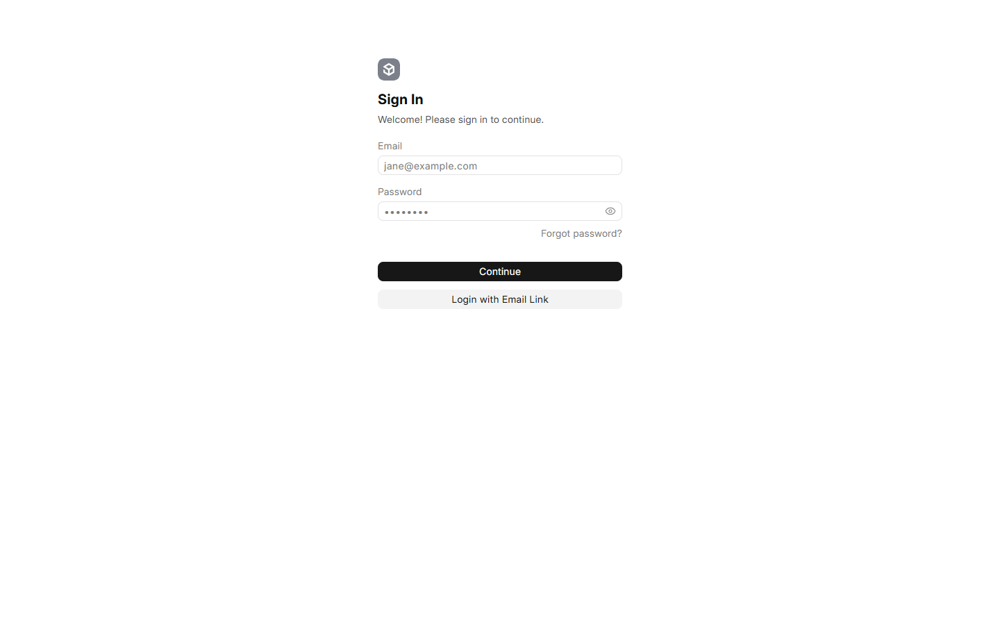

FS Switch is a Frappe app and Vue console for operating FreeSWITCH. It can run
on the bundled Docker stack for a lab or evaluation, or on an existing Frappe
bench that already has MariaDB, Redis and FreeSWITCH.

> **Alpha.** The console, compiler, Tenant model and ESL live views are
> implemented, but FS Switch is not production-ready without lab-testing your
> FreeSWITCH deployment. Start with a non-production site and non-production
> phone numbers.

## Before you begin

For the Docker path you need:

- Docker Desktop or Docker Engine with Compose v2.
- A host that can reach the FreeSWITCH ports listed below.
- About 30–60 minutes for the first build. FreeSWITCH is compiled from source;
  later builds reuse the cached layer.

The compose file publishes:

| Port | Purpose |
|---|---|
| `8000` | Frappe and the FS Switch console |
| `9000` | Frappe Socket.IO |
| `5060/udp`, `5060/tcp` | SIP |
| `5066` | WebRTC WebSocket (`ws://` locally) |
| `7443` | Secure WebRTC WebSocket (`wss://`, trusted certificate required) |
| `16384–16484/udp` | RTP media |

If the RTP range is already in use, set `FS_SWITCH_RTP_START` and
`FS_SWITCH_RTP_END` to a free range in `.env`.

## Option A: Docker stack

### 1. Get the source

```bash
git clone https://github.com/FarmerChazman/fs_switch.git
cd fs_switch
```

### 2. Create the environment file

```bash
cp .env.example .env
```

Open `.env` and replace every `CHANGE_ME` value. At minimum, set strong values
for:

- `FS_SWITCH_DB_ROOT_PASSWORD` - the MariaDB root password.
- `FS_SWITCH_ADMIN_PASSWORD` - the Frappe `Administrator` password.
- `FS_SWITCH_XML_CURL_SECRET` - a long random secret shared with FreeSWITCH.
- `FS_SWITCH_ESL_PASSWORD` - the FreeSWITCH Event Socket password.

For a local lab, keep the WebRTC defaults:

```dotenv
FS_SWITCH_SITE=fs-switch.localhost
FS_SWITCH_WEBRTC_URL=ws://localhost:5066
FS_SWITCH_SIP_DOMAIN=localhost
FS_SWITCH_PUBLIC_IP=127.0.0.1
FS_SWITCH_MAIN_DID=1000
FS_SWITCH_DEFAULT_TENANT=default
FS_SWITCH_DEFAULT_CONTEXT=default
```

Generate the XML-curl secret rather than making one up:

```bash
openssl rand -hex 32
```

### 3. Build and start

```bash
docker compose up -d --build
```

The first start creates the Frappe site, installs FS Switch, migrates the
database, builds the console and writes the FreeSWITCH configuration. The
FreeSWITCH container waits for Frappe to become healthy before it starts, so
`callcenter.conf` is available on the first boot.

Check the stack:

```bash
docker compose ps
docker compose logs -f frappe
```

`frappe` should become healthy and `freeswitch` should stay running. A
`frappe` health check can take a few minutes on the first boot.

### 4. Open the console

Open:

```text
http://fs-switch.localhost:8000/fs-switch
```

If your browser or operating system does not resolve `.localhost` names, use
the site hostname from `.env` after adding it to your hosts file.



*Sign in with `Administrator` and the password from `FS_SWITCH_ADMIN_PASSWORD`.
A normal login at `/login` also lands on the FS Switch console.*

The first boot creates a Tenant named by `FS_SWITCH_DEFAULT_TENANT` (default:
`default`). You can add more Tenants later from **Administration**. New
extensions, queues, gateways and Flows default to the active Tenant.

Next: [Your first steps with FS Switch](first-steps.md).

## Option B: Existing Frappe bench

Use this path when Frappe, MariaDB, Redis and FreeSWITCH already run outside the
bundled compose stack.

```bash
bench get-app https://github.com/FarmerChazman/fs_switch.git
bench --site your.site install-app fs_switch
bench --site your.site migrate
```

Build the console:

```bash
cd apps/fs_switch/frontend
npm ci
npm run build
```

The build writes the console to
`apps/fs_switch/fs_switch/public/console`, and the page is served at
`/fs-switch`.

You still need to connect FreeSWITCH:

1. Open **FS Switch Settings** and set the SIP domain, WebRTC URL, public IP,
   main DID and XML-curl secret.
2. Point the FreeSWITCH `directory`, `dialplan` and `configuration` XML-curl
   bindings at
   `https://<site>/api/method/fs_switch.api.xml_curl?secret=<secret>`.
3. Set the ESL host, port and password in **FS Switch Settings**.
4. Restart or reload FreeSWITCH and confirm the console top bar shows
   **FreeSWITCH connected**.

See [`operations.md`](operations.md) for the XML-curl, ESL, cache and
troubleshooting details.

## Verify the installation

| Check | Command or place |
|---|---|
| Frappe is up | `curl -fsS http://fs-switch.localhost:8000/api/method/ping` |
| Console assets are present | `/assets/fs_switch/console/index.html` returns 200 |
| FreeSWITCH is reachable | Console top bar shows **FreeSWITCH connected** |
| XML-curl works | Request the dialplan endpoint with the configured secret |
| Live data is readable | Empty or populated grids appear under **Live** |

The console shows a green **Live push** badge when the Socket.IO connection is
active. If the socket is disconnected, it polls a live snapshot every 30 seconds
as a fallback.

## Upgrade

### Docker

```bash
git pull
docker compose build
docker compose up -d
```

The Frappe entrypoint syncs the app source from the image into the existing
bench, registers the app if needed, and runs `bench migrate` before starting.
The site volume is preserved. The FreeSWITCH Dockerfile copies project config
after the source compile, so a config-only change reuses the cached FreeSWITCH
build.

### Existing bench

Update the app from its source, then migrate and rebuild the console:

```bash
cd frappe-bench
bench update --apps fs_switch
bench --site your.site migrate
cd apps/fs_switch/frontend
npm ci
npm run build
```

## Troubleshooting

### The first build is taking a long time

The first FreeSWITCH build compiles FreeSWITCH and its dependencies from source.
It commonly takes 30–60 minutes. Later builds reuse the cached compile layer.

### Frappe never becomes healthy

Check the logs:

```bash
docker compose logs -f frappe
```

The usual causes are a missing required value in `.env`, a database password
change on an existing volume, or a failed first migration. Do not delete the
`fs-switch-sites` volume unless you intend to lose the site.

### The console says FreeSWITCH is not connected

- Check that `FS_SWITCH_ESL_PASSWORD` matches in `.env`, **FS Switch Settings**
  and the FreeSWITCH event-socket configuration.
- Check `docker compose logs freeswitch`.
- Check that the Frappe container can reach the FreeSWITCH ESL port.
- Restart FreeSWITCH after changing its event-socket configuration.

### A browser softphone does not register

- Use `ws://localhost:5066` for a local stack. `wss://` needs a trusted
  certificate; the self-signed local certificate is not trusted by browsers.
- Confirm the extension's SIP password and SIP domain in **My extension**.
- Confirm the browser can reach port `5066` and the RTP range.
- The local `webrtc` profile accepts RFC1918 ICE candidates. For an
  internet-facing deployment, use a WAN or TURN candidate ACL and TLS.

### A Flow is saved but calls still use the old routing

FreeSWITCH is served the **Published** version only. Saving changes the Draft;
use **Publish** in the Flow toolbar or the Dialplans list. If a publish reports
that `reloadxml` failed, run `reloadxml` from `fs_cli` and verify the call path.

### Where do I report a problem?

Raise an issue at
<https://github.com/FarmerChazman/fs_switch/issues> with the commands you ran,
the error output and the FS Switch commit.

## Security notes

- Never commit `.env`. It contains the database, ESL and XML-curl secrets.
- Treat the XML-curl secret as a bearer secret. Restrict access to the Frappe
  endpoint with TLS, a reverse proxy or network policy.
- Keep the console and Socket.IO behind TLS before exposing them outside a
  trusted network.
- FreeSWITCH and the console are separate services. Opening SIP or RTP to the
  internet without a firewall, TLS and a TURN plan is not a supported
  production setup.
- Review [`SECURITY.md`](../SECURITY.md) before a production deployment.
