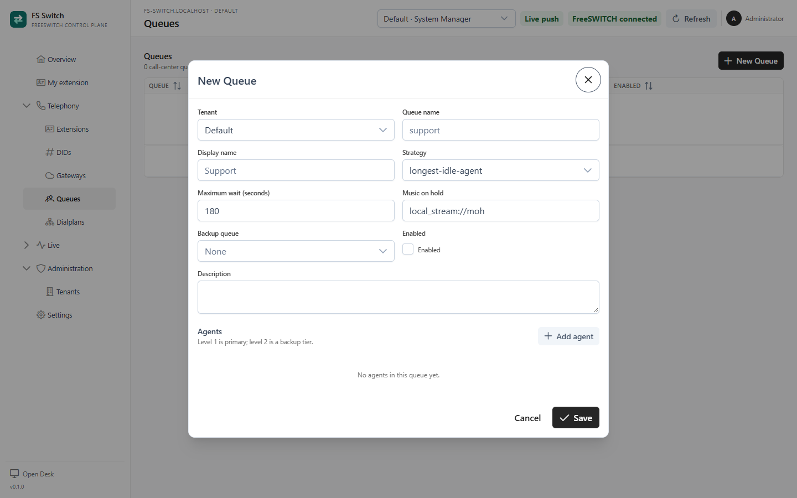

A **queue** is a call-center ring group. It routes waiting callers to available
agents according to a strategy, a maximum wait and a music-on-hold file. Queues
are Tenant-scoped, and every agent or backup queue must belong to the same
Tenant.


*The active Tenant's queues*

## Create a queue

1. Select the Tenant in the top bar.
2. Open **Telephony → Queues**.
3. Click **New Queue**.
4. Enter a queue name and display name.
5. Choose a **Strategy**.
6. Set **Maximum wait (seconds)**. The default is 180.
7. Choose the music-on-hold file.
8. Optionally select a **Backup queue** in the same Tenant.
9. Keep **Enabled** on.
10. Add agents and save.



*Creating a queue and adding agents*

## Queue fields

| Field | Purpose |
|---|---|
| **Queue name** | Natural queue name, for example `support`. Unique inside the Tenant. |
| **Display name** | Operator-facing label. |
| **Strategy** | How a waiting call chooses an agent. |
| **Maximum wait (seconds)** | Longest queue wait before the queue stops offering the call. |
| **Music on hold** | Playback applied while the caller waits. |
| **Backup queue** | A same-Tenant queue whose agents are added as a lower tier. |
| **Agents** | Extension links with a level and position. |
| **Enabled** | Whether the queue is included in `callcenter.conf`. |
| **Description** | Internal notes. |

### Strategies

| Strategy | Behaviour |
|---|---|
| `longest-idle-agent` | Offers the call to the available agent who has been idle longest. |
| `round-robin` | Rotates offers between available agents. |
| `agent-with-least-talk-time` | Prefers the agent with the least talk time. |
| `agent-with-fewest-calls` | Prefers the agent with the fewest answered calls. |
| `ring-all` | Rings all available agents. |

The strategy is passed to FreeSWITCH's `callcenter` module. The exact queue
behaviour, including ring progress and no-answer handling, is FreeSWITCH's; FS
Switch supplies the configuration.

### Agents and tiers

The Agents table links an **FS Extension** to the queue. Level 1 is the primary
tier; level 2 is a backup tier. Positions control ordering where the strategy
uses it.

A queue only loads agents that:

- are enabled;
- belong to the same Tenant;
- are selected as queue agents (or as agents of a backup queue);
- exist in FreeSWITCH's loaded `callcenter.conf`.

An agent's **Available**, **On Break** or **Logged Out** status is set from
**My extension** or **Live → Agents**. A queue call is not offered to an agent
who is not available.

If a backup queue is selected, its agents are added at level 2 when the backup
queue belongs to the same Tenant. They are not duplicated if already primary
agents.

## How the queue is served

The queue configuration is part of the global `callcenter.conf` document. Each
queue and agent name is scoped with the Tenant context:

```text
support@acme
7101@acme
```

FreeSWITCH requests `callcenter.conf` as configuration, not as a dialplan
context, so the document includes every enabled Tenant's queues. Queue changes
invalidate the callcenter cache after commit. FreeSWITCH fetches the new
document on its next config request; run `reloadxml` if the runtime still shows
the old queue.

## Live queue metrics

**Live → Wallboard** projects the live snapshot into:

- waiting calls and longest wait;
- available, busy, on-break and logged-out agents;
- active calls and answer rate;
- per-queue depth, configured max wait and answered/abandoned counters;
- active call paths from caller to queue to agent.

The wallboard refreshes every 10 seconds and also applies live Socket.IO events.
Queue waiting is counted from active `callcenter` channels, not from a synthetic
counter. A call path is de-duplicated by `call_uuid`.

## Test a queue call

1. Register the agent extension on a softphone.
2. Set the agent to **Available**.
3. Publish a Flow that routes a call to this queue.
4. Call the Flow destination.
5. Confirm the call in **Live → Channels** and the queue/agent path in
   **Live → Wallboard**.
6. Answer from the softphone and verify two-way audio.

If the queue does not ring:

- confirm the extension is enabled and in the queue;
- confirm agent status is **Available**;
- confirm the Flow uses the queue name and the queue context is the Tenant
  context;
- confirm FreeSWITCH loaded the queue and tier (`callcenter_config queue list`
  and `callcenter_config agent list`);
- confirm the agent is registered and not already busy.

## Disable or delete

Disabling a queue removes it from the next `callcenter.conf` fetch. Delete is
permanent; remove or reassign its agent links first.

A queue cannot be moved to another Tenant. Create a new queue in the target
Tenant if ownership changes.

## Limits

- There is no wrap-up workflow or per-queue recording policy yet.
- The wallboard is a live projection; it is not a historical reporting system.
- Queue statistics such as answered/abandoned counters come from FreeSWITCH and
  are not a replacement for CDR or a BI warehouse.
- Multi-Tenant queue hosting was lab-tested, but real-time recipient isolation
  and carrier trunks still need a production acceptance pass.

## Related pages

- [Extensions](extensions.md)
- [Flows](flows.md)
- [Live operations](live-operations.md)
- [Tenants and membership](tenants.md)
- [Settings](settings.md)
