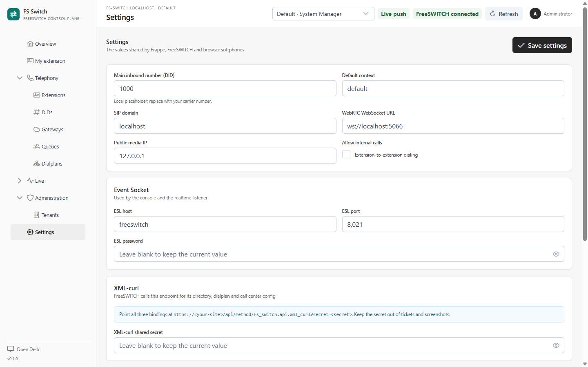

**Settings** contains the values shared by Frappe, FreeSWITCH and browser
softphones. In the console it is restricted to **System Managers**. Tenant
Admins configure their own Tenant on the Tenant form, not on this page.



*Global settings for Frappe, FreeSWITCH and browser softphones*

## Settings reference

| Field | Purpose |
|---|---|
| **Main inbound number (DID)** | Number the shared `public` context forwards into the global default context. |
| **Default context** | Global fallback context and target for the main-DID public transfer. |
| **SIP domain** | Global fallback SIP domain when a Tenant does not define one. |
| **WebRTC WebSocket URL** | URL shown to extension owners for a softphone, for example `ws://localhost:5066`. |
| **Public media IP** | Public/RTP address FreeSWITCH advertises. |
| **Allow internal calls** | Compiles the extension-to-extension bridge rule. |
| **ESL host / port / password** | Event Socket connection used by live views and the listener. |
| **XML-curl shared secret** | Shared secret in the URL FreeSWITCH uses for XML-curl. |
| **Default IVR prompt** | Default playback used by IVR steps when a Flow does not override it. |
| **Queue hold music** | Default queue music-on-hold. |
| **Voicemail path** | Voicemail storage path. |
| **Recording path** | Recording storage path. |
| **Default gateway** | Reference to an FS Gateway for outbound configuration and future features. |
| **Outbound caller ID** | Global outbound caller-ID fallback. |
| **Record calls** | Global recording preference. |

Passwords and the XML-curl secret are write-only in the console. Leave a
password field blank to keep the current value. Entering a value replaces it.

## Docker and environment precedence

On the Docker stack the entrypoint applies values from `.env` to the settings at
startup. An environment value takes precedence over the saved value; if the
environment variable is empty, the saved value is kept. This keeps the Frappe
settings and the FreeSWITCH container configuration in sync.

The shared values in `.env` include:

```dotenv
FS_SWITCH_MAIN_DID=1000
FS_SWITCH_DEFAULT_CONTEXT=default
FS_SWITCH_SIP_DOMAIN=localhost
FS_SWITCH_WEBRTC_URL=ws://localhost:5066
FS_SWITCH_PUBLIC_IP=127.0.0.1
FS_SWITCH_XML_CURL_SECRET=...
FS_SWITCH_ESL_PASSWORD=...
```

On a manual install, the console settings and FreeSWITCH's
`xml_curl.conf.xml`, event-socket configuration and SIP profile must be kept in
sync by the operator. The settings page does not rewrite a manual FreeSWITCH
installation.

## XML-curl

FreeSWITCH requests three document kinds from the same endpoint:

```text
https://<site>/api/method/fs_switch.api.xml_curl?secret=<secret>
```

- directory;
- dialplan;
- configuration (`callcenter.conf`).

The secret must match the one used by FreeSWITCH. Keep it out of tickets,
screenshots and commits. The handler serves the Published XML and the
last-known-good cache; a full database outage still fails at Frappe HTTP
middleware before the handler runs.

The endpoint is protected by the shared secret, not by the user session. Treat
it as a service credential.

## Event Socket

The ESL host/port/password are used by:

- the live snapshot and live actions;
- the background ESL listener that publishes call, agent and registration
  events.

The Docker compose file keeps the ESL port on the private network; it is not
published to the host. If the top bar cannot show **FreeSWITCH connected**, check
these values first, then the FreeSWITCH event-socket ACL and logs.

## Main DID and default context

These two values are global in this alpha:

- the `public` context forwards the **Main inbound number**;
- the transfer target is the **Default context**, not a per-Tenant context.

A second Tenant with its own context needs a context-correct carrier/FreeSWITCH
route. See [DIDs and inbound numbers](dids.md) and
[Gateways and carrier trunks](gateways.md).

## Media and recording

- **Default IVR prompt** and **Queue hold music** are FreeSWITCH playback paths,
  not uploaded files.
- A Flow can override the prompt with its own node path.
- The recording path is used by recording features; the current alpha does not
  provide a recording browser or retention policy.
- Voicemail storage and transcription are outside the current console.

## Saving settings

1. Open **Administration → Settings** as a System Manager.
2. Change non-secret values.
3. Enter a secret only when rotating it; leave it blank to keep the current one.
4. Click **Save settings**.
5. Reload FreeSWITCH/XML-curl or restart the stack only when the changed value
   requires it.

Changing settings invalidates the call-setup cache. If you change a value that
FreeSWITCH has already loaded, run `reloadxml` or restart FreeSWITCH.

## Security

- Do not expose the XML-curl secret or ESL password in screenshots.
- Keep `.env` and the database backup private.
- Use TLS for the console, Socket.IO and WebRTC in any shared environment.
- Restrict the ESL port to the Frappe container network.
- Treat the default Tenant fallback and the main DID as operational routing
  decisions, not security boundaries.

## Related pages

- [Installation](installation.md)
- [Tenants and membership](tenants.md)
- [Gateways and carrier trunks](gateways.md)
- [DIDs and inbound numbers](dids.md)
- [Live operations](live-operations.md)
- [`operations.md`](operations.md) - cache, listener and runtime checks
