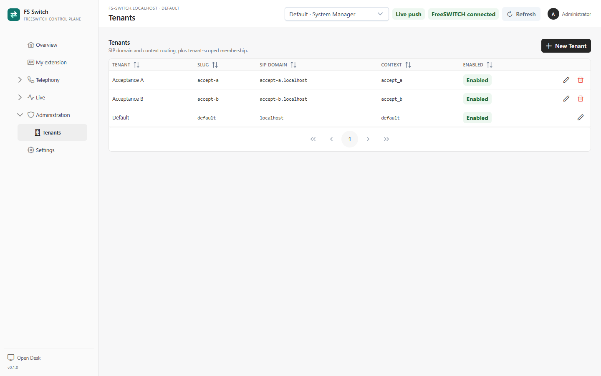
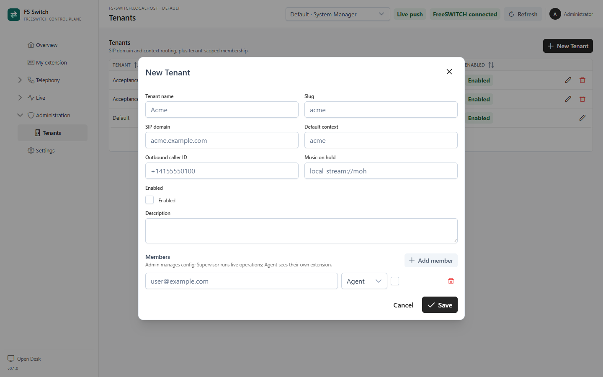

A **Tenant** is one customer organisation in FS Switch. It owns its SIP domain,
default context, inbound numbers, extensions, queues, gateways and Flows.
Tenant membership is what lets a user see and operate that Tenant's data.

This page covers creating a second Tenant, adding members and understanding the
difference between the three Tenant roles.

*Tenants visible to a System Manager*

## What a Tenant controls

| Field | Purpose |
|---|---|
| **Tenant name** | Display name used in the console and selectors. |
| **Slug** | Stable identifier used in document names and routing. It cannot be changed after creation. |
| **SIP domain** | The domain used for directory lookup and WebRTC registration. Must be unique among enabled Tenants. |
| **Default context** | The FreeSWITCH context that owns this Tenant's Flows. Must be unique among enabled Tenants. |
| **Outbound caller ID** | Fallback caller ID for extensions in this Tenant. |
| **Music on hold** | Tenant-specific hold music, for example `local_stream://moh`. |
| **Description** | Internal notes. |
| **Members** | Users and their Tenant roles. |
| **Enabled** | Disabled Tenants are removed from routing and membership checks. |

SIP domains and default contexts are routing labels, not security boundaries.
Frappe membership and row-level hooks enforce access. FreeSWITCH uses the labels
to decide which Tenant's directory, dialplan and queue configuration to fetch.

## Create a second Tenant

Only a **System Manager** can create a Tenant. A Tenant Admin can edit its own
Tenant and membership, but cannot create or delete a Tenant.

1. Open **Administration → Tenants**.
2. Click **New Tenant**.
3. Set **Tenant name** and **Slug**. The slug becomes the Tenant's document
   prefix and cannot be changed later.
4. Set **SIP domain** and **Default context**. Use lowercase labels that match
   the SIP domain and FreeSWITCH context the Tenant will use, for example
   `acme.example.com` and `acme`.
5. Optionally set an outbound caller ID and music-on-hold file.
6. Leave **Enabled** on when the Tenant is ready.
7. Add members and choose their roles.
8. Click **Save**.

*Creating a Tenant and adding a member*

The new Tenant appears in the top-bar selector. New extensions, queues,
gateways, DIDs and Flows default to the active Tenant after you switch to it.

## Add or invite members

The member row accepts an **existing Frappe user**. FS Switch does not create a
Frappe user or send an invitation email from this form.

To invite someone who does not have an account:

1. Open **Open Desk** and create or invite the user in **User**.
2. Return to **Administration → Tenants**, edit the Tenant and click
   **Add member**.
3. Enter the exact Frappe user email and choose a role.
4. Keep the member enabled and save.

If the email does not match an existing **User**, the save fails with
`User <email> does not exist.` The member must be created first.

### Tenant roles

| Role | Can read configuration | Can change configuration | Publish / rollback | Live state | Live actions | Own extension |
|---|---:|---:|---:|---:|---:|---:|
| **Admin** | Yes | Yes | Yes | Yes | Yes | Yes |
| **Supervisor** | Yes | No | No | Yes | Yes | Yes |
| **Agent** | Own extension only | No | No | No | No | Yes |
| **System Manager** | All Tenants | All Tenants | Yes | All Tenants | Yes | n/a |

A user can be a member of several Tenants with a different role in each. The
Frappe roles are global and additive; the row-level hooks keep the actual data
scoped to the selected Tenant.

Role changes are projected after the Tenant save commits. If a user does not see
the new navigation immediately, reload the console.

### Disable or remove a member

Clear the member's checkbox to disable the membership. The user loses that
Tenant's access after role projection. Removing the row works the same way.
Reload the user's console if their sidebar is already open.

## Switch Tenants

The **Active Tenant** selector is in the top bar. It changes:

- the lists and forms shown in the workspace;
- the Tenant used for new documents;
- the live snapshot and Socket.IO events.

The selection is remembered in the browser when the user still belongs to the
Tenant. Switching Tenants does not move existing documents; a document's Tenant
is fixed after creation.

## Tenant-qualified names

Documents are stored with a Tenant-qualified name such as
`accept-a::7101`, `accept-a::accept_support` or
`accept-a::Acceptance A inbound`. The natural key - `7101`, `accept_support`
or the Flow title - stays readable and is unique inside that Tenant.

This lets two Tenants use the same extension number or queue name. FreeSWITCH
receives natural names scoped by context, so operators still see `7101` and
`accept_support`, not the internal document name.

## Default Tenant

`FS Switch Settings → Default tenant` names the Tenant used when FreeSWITCH
supplies an unknown or generic routing label. The default Tenant:

- cannot be disabled;
- cannot be deleted;
- is created on a fresh install and named by `FS_SWITCH_DEFAULT_TENANT`.

Do not point the default Tenant at a customer if unknown labels should fail
closed. The fallback is operationally useful on a single-Tenant lab, but it can
hide a misconfigured context or domain.

## Disable or delete a Tenant

Disabling a Tenant removes it from the routing map and from enabled membership
checks. Its documents are not deleted. A call whose label resolves to a disabled
Tenant falls back to the default Tenant, so verify that this is what you want.

Deleting a Tenant is permanent and is limited to System Managers. The default
Tenant cannot be deleted. Remove or migrate the Tenant's documents first; do not
delete a Tenant while it still owns active routing.

## Troubleshooting

| Symptom | Check |
|---|---|
| A user cannot see a Tenant | Is the member enabled? Does the User exist? Did the user reload after the Tenant save? |
| A Tenant is missing from the selector | Is it enabled? Does the user have an enabled membership? |
| `SIP domain already belongs to Tenant ...` | SIP domains must be unique among enabled Tenants. Disable or change the other Tenant. |
| `Context ... already belongs to Tenant ...` | Default contexts must be unique among enabled Tenants. |
| A Flow was created in the wrong Tenant | The Tenant field is fixed. Create a new Flow in the correct Tenant; you cannot move it. |
| An Agent can see another extension | Check the membership role and row-level permission; an Agent should only see their own extension. |
| A new Tenant's calls go to the default Tenant | Check the SIP domain/context against the actual FreeSWITCH labels and the main DID routing. |

## Related pages

- [DIDs and inbound numbers](dids.md)
- [Gateways and carrier trunks](gateways.md)
- [Extensions](extensions.md)
- [Flows](flows.md)
- [Settings](settings.md)
